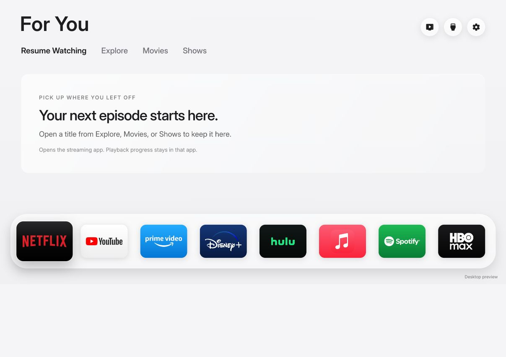

# Calm Home

A quiet Samsung TV home screen, based on [Free My TV](https://github.com/simbasjungles/free-my-tv). Your apps, HDMI inputs, and a photo screensaver, with setup guidance you can give to ChatGPT, Codex, or Claude.



## Set it up with your AI

Download this repository as a ZIP, extract it on the computer that will connect to the TV, and give your AI assistant this request:

> Help me install Calm Home from https://github.com/Goy2Joy/calm-home. Read AGENT_SETUP.md and check my computer and TV first. Download the official tools I need, reuse anything already installed, and guide me through the remote, Samsung certificate and physical TV checks. Keep my keys and certificates local. Start with a normal app installation; handle Home/startup integration only after checking compatibility and agreeing on recovery with me.

Open **[the AI setup guide](AGENT_SETUP.md)** for the full workflow. The helper uses Python's standard library; there are no Python packages to install.

```sh
python3 setup.py doctor
python3 setup.py download-tools --dry-run
python3 setup.py download-tools
```

On Windows, use `py -3` instead of `python3`. The download helper saves the official installer locally; you complete its license and Samsung account/certificate screens yourself. SDB comes with Tizen Studio. Samsung's TV and certificate extensions are installed through its Package Manager.

## What you get

- Resume Watching, Explore, Movies and Shows, in that order.
- Streaming-app tiles with bundled brand artwork; Samsung Apps under All Apps.
- TV-reported HDMI inputs, including sleeping/disconnected devices.
- Aerial/orbital photo crossfades with a small clock and foreground-only Samsung screensaver management.
- An explicit Samsung Home fallback.

Resume Watching remembers titles opened from this launcher. It reopens the provider app; it does not read Netflix/Prime playback positions or resume an exact episode.

## Compatibility and verified results

| Feature | Status |
|---|---|
| Computer setup | macOS Apple Silicon, using Rosetta, tested; official Windows downloads provided, Windows installation not tested here |
| App target | Samsung Tizen 8.0; other TV models still need their own install/device tests |
| Home button | Physically tested from Netflix and YouTube on UN65CU7000DXZA |
| Samsung Home recovery | Physical restore and reapply tested |
| Startup | Standby/wake and full cold restart physically confirmed |
| HDMI, aerial saver, Samsung Apps | Confirmed on the reference TV |
| System debloating | No system-package removal or service-disable changes included |

Advanced integration is currently guarded for **UN65CU7000DXZA / T-KSU2ECAKUC-0080-REL-202412040254** only, with exact system-library and boot-manager checks. A similar model name or “Tizen 8” alone does not establish root compatibility. See [advanced Home/startup integration and recovery](docs/advanced-home.md).

## Your own artwork key

Live film/show artwork uses your own [TMDB API key](https://developer.themoviedb.org/docs/getting-started). Have your AI store it in a local environment variable, then run:

```sh
python3 setup.py configure --tmdb-env CALM_TMDB_KEY
```

The helper keeps it under ignored `.setup/` and puts it into your personal build. Do not upload that signed package or share your certificate. The repository contains no API key or pre-signed TV package.

## Build, sign and install

After creating your own Samsung TV certificate profile, including your TV's DUID:

```sh
python3 setup.py build --profile CalmHome
python3 setup.py connect --tv-ip YOUR_TV_IP
python3 setup.py install --tv-ip YOUR_TV_IP
python3 setup.py launch --tv-ip YOUR_TV_IP
```

Use the address shown on your own TV. Those commands do not root the TV or change its default Home/startup behavior. Follow [AGENT_SETUP.md](AGENT_SETUP.md) for the physical checks and optional advanced phase.

## Credits

The interface derives from Free My TV, pinned at `62e883b3179c8cafb7a2b09960eabfe7eea6ef1c`. See [THIRD-PARTY-NOTICES](app/THIRD-PARTY-NOTICES.txt). MIT license and notices are retained. App names and logos belong to their respective owners. NASA/ISS crews supplied the aerial photographs. No Samsung, Apple, streaming-provider or NASA endorsement is implied.

This product uses the TMDB API but is not endorsed or certified by TMDB. The application includes the approved TMDB logo and notice in About & credits. Source code is MIT licensed; third-party media, fonts, marks, and the optional root dependency retain their own notices.

## Checks

```sh
node --test tests/*.test.cjs
python3 -m unittest discover -s tests -p 'test_*.py'
```

The setup helper has tests for private target addresses, official download restrictions, corrupt installers and SDB's misleading zero-exit connection errors. These are local checks, not proof that a new TV works.
